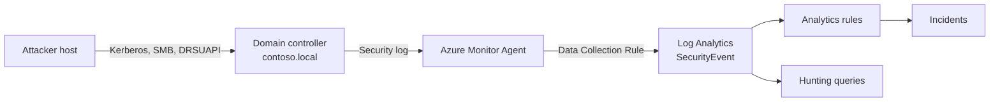

# Active Directory Attack Detection Lab

[](https://github.com/singh-adi5/Agent/actions/workflows/ci.yml)

Microsoft Sentinel detections for Kerberos and directory replication attacks against
Active Directory, managed as code. Each technique has a scheduled analytics rule, a
hunting query, test cases that run on a Kusto engine in CI, and notes on tuning,
coverage gaps and response.

The content runs on the `SecurityEvent` table, populated by the Azure Monitor Agent
from domain controller Security logs, so it needs no Defender for Identity licence.
The lab it is validated in (Azure, Windows Server 2022, `contoso.local`) holds no
production data.

## Coverage

| Technique | ATT&CK | Events | Severity | Runs / looks back | Status |
|---|---|---|---|---|---|
| [Kerberoasting](detections/kerberoasting/README.md) | [T1558.003](https://attack.mitre.org/techniques/T1558/003/) | 4769 | Medium | 1h / 65m | Emulator-tested |
| [AS-REP roasting](detections/asrep-roasting/README.md) | [T1558.004](https://attack.mitre.org/techniques/T1558/004/) | 4768 | Medium | 1h / 65m | Emulator-tested |
| [Golden Ticket](detections/golden-ticket/README.md) | [T1558.001](https://attack.mitre.org/techniques/T1558/001/) | 4768, 4769, 4770 | Medium | 1h / 12h | Emulator-tested |
| [DCSync](detections/dcsync/README.md) | [T1003.006](https://attack.mitre.org/techniques/T1003/006/) | 4662, 4624 | High | 15m / 1h | Emulator-tested |
| [Password spraying](detections/password-spraying/README.md) | [T1110.003](https://attack.mitre.org/techniques/T1110/003/) | 4771, 4625 | Medium | 15m / 30m | Emulator-tested |

**Emulator-tested:** in CI, the analytic rule fires on its attack cases and stays
silent on its benign cases when run on a Kusto engine, and the hunting query returns
the attack cases.
**Lab-validated:** also seen raising an incident on simulated activity in a live
workspace, with evidence in [docs/evidence](docs/evidence/README.md). Lab validation
is in progress.

## Architecture



A Data Collection Rule forwards seven Security event IDs from the domain controller.
Analytics rules run on a schedule and raise incidents with account, address and host
entities; hunting queries cover the same techniques over longer ranges without
thresholds. Details and design decisions are in [docs/architecture.md](docs/architecture.md).

## Repository layout

```
detections/<technique>/
    analytic.yaml    Sentinel scheduled analytics rule
    hunting.yaml     Sentinel hunting query
    tests.json       cases the rule must fire on, and stay silent on
    README.md        logic, tuning, coverage gaps, validation, response
deploy/              Data Collection Rule for the SecurityEvent stream
docs/                architecture, lab setup, deployment, simulation, testing, standards
tools/               content linter, KQL parser check, emulator test runner, ARM build
tests/               unit tests for tools/
```

## Usage

Requires Python 3.11+, Node.js 18+ and make. The emulator tests also need Docker.

```bash
make install         # pinned, hash-verified dependencies
make check           # content lint, ruff, unit tests, KQL parse
make emulator        # start the Kusto emulator on localhost:8080
make emulator-test   # run every query against its test cases
make arm             # build/sentinel-analytics.json for deployment
```

- Deploy the rules: [docs/deployment.md](docs/deployment.md)
- Build the lab: [docs/lab-setup.md](docs/lab-setup.md)
- Validate against real telemetry: [docs/simulation.md](docs/simulation.md)
- Add a detection or test case: [docs/testing.md](docs/testing.md)

## Design notes

- Each query exists once, in its YAML file. The linter, parser check, emulator tests
  and ARM build all read it from there.
- Queries may only read columns listed in [tools/securityevent.schema](tools/securityevent.schema),
  which is checked against Microsoft's table reference. `TicketEncryptionType` and
  `PreAuthType` are not columns in `SecurityEvent`; the queries parse them from
  `EventData`.
- Account names and source addresses are normalised (lower case, realm removed,
  `::ffff:` stripped) before any join or count, and counts are aggregated across
  domain controllers.
- Detection windows include the five-minute delay Sentinel applies to scheduled runs,
  so no events fall between two runs. Incident grouping absorbs the resulting
  duplicate alerts.
- Rules deploy disabled. Allow-lists, such as the DCSync domain controller list, are
  set per environment before a rule is enabled.

## Limitations

- Lab validation is in progress; see the Status column above.
- The lab has one domain controller. The Golden Ticket rule depends on Kerberos events
  from every DC and will produce false positives if any DC is not collected.
- Detection is directory-side only. There is no endpoint telemetry from the attacking
  host.
- Known evasions are listed per technique, including AES Kerberoasting, silver and
  diamond tickets, distributed password sprays and DCSync from a genuine DC account.

## Standards

Detections map to MITRE ATT&CK techniques and mitigations. Logging and alerting are
mapped to OWASP Top 10 A09, NIST SP 800-53 (AU-2, AU-6, AU-12, SI-4) and CIS Controls
v8; the CI pipeline is assessed against the OWASP Top 10 CI/CD Security Risks. See
[docs/standards.md](docs/standards.md).

## Security

Offensive tools referenced here are for the lab only. See [SECURITY.md](SECURITY.md)
for authorised use and how to report a problem.

## License

[MIT](LICENSE)
