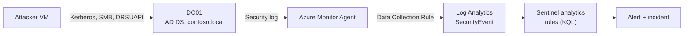

# Active Directory Attack Detection Lab

**Azure and Microsoft Sentinel.** Detection engineering for Kerberoasting, DCSync,
Golden Ticket and password spraying, plus AS-REP roasting. Each attack has a KQL
hunting query, a Sentinel analytics rule in YAML, a MITRE ATT&CK mapping, a lab
simulation guide for Impacket and Rubeus, and tuning notes.

This is an independent lab on synthetic data. The domain is `contoso.local`. There
are no real systems, accounts or identifiers anywhere in it.

[](https://github.com/singh-adi5/Agent/actions/workflows/kql-validate.yml)

## Detections

| Attack | ATT&CK | Data source | Severity | Status |
|---|---|---|---|---|
| [Kerberoasting](detections/kerberoasting/README.md) | [T1558.003](https://attack.mitre.org/techniques/T1558/003/) | `SecurityEvent` 4769 | Medium | Logic validated |
| [AS-REP roasting](detections/asrep-roasting/README.md) | [T1558.004](https://attack.mitre.org/techniques/T1558/004/) | `SecurityEvent` 4768 | Medium | Logic validated |
| [DCSync](detections/dcsync/README.md) | [T1003.006](https://attack.mitre.org/techniques/T1003/006/) | `SecurityEvent` 4662, 4624 | High | Logic validated |
| [Password spraying](detections/password-spraying/README.md) | [T1110.003](https://attack.mitre.org/techniques/T1110/003/) | `SecurityEvent` 4771, 4625 | Medium | Logic validated |
| [Golden Ticket](detections/golden-ticket/README.md) | [T1558.001](https://attack.mitre.org/techniques/T1558/001/) | `SecurityEvent` 4768, 4769, 4770 | Medium | Logic validated |

**Status** is honest on purpose:

- **Logic validated** — the query parses against Microsoft's Kusto language service,
  reads only real `SecurityEvent` columns, passes the schema and ATT&CK checks, and
  **fires correctly against sample events on a real Kusto engine in CI** (true
  positives fire, tuned-out cases stay silent).
- **Fired in lab** — additionally seen raising an incident on simulated activity in
  a live workspace, with a screenshot in [`docs/evidence/`](docs/evidence/).

## Hunting queries

Each detection also has a hunting query in [`hunting/`](hunting/README.md): the same
attack with no threshold and no short window, for an analyst to read over days or
weeks. They find what the rules are tuned to ignore, such as slow roasting, and they
produce the baselines the rules' allow-lists need.

No detection is marked "Fired in lab" until that evidence exists. See
[PROGRESS.md](PROGRESS.md).

## Architecture



A Windows domain controller streams its Security event log through the Azure Monitor
Agent and a filtered Data Collection Rule into the `SecurityEvent` table. Four
scheduled analytics rules run the KQL and raise incidents with mapped entities. Full
version in [docs/ARCHITECTURE.md](docs/ARCHITECTURE.md).

## Repository layout

```
detections/<attack>/   query.kql, rule.yaml, README.md   (analytics rules)
hunting/               <attack>.kql, <attack>.yaml       (hunting queries)
simulations/<attack>.md                                  (how to generate the telemetry)
deployment/            yaml_to_arm.py, dcr-securityevent.json, deploy-rules.md
docs/                  SETUP.md, ARCHITECTURE.md, STANDARDS.md, evidence/
scripts/               validate_rules.py, kql_check.js, securityevent.schema
tests/                 test_tooling.py, run_logic_tests.py, logic/<detection>.json
.github/workflows/     kql-validate.yml
```

## Use it

Stand the lab up and reproduce the detections end to end:

1. **Build the lab** — [docs/SETUP.md](docs/SETUP.md): Azure network, domain
   controller, attacker host, Sentinel workspace, agent and collection rule.
2. **Deploy the rules** — [deployment/deploy-rules.md](deployment/deploy-rules.md):
   convert the YAML to an ARM template and import, or create by hand.
3. **Simulate and confirm** — the guides in
   [simulations/](simulations/): generate the telemetry, confirm the rule fires,
   screenshot the incident into [docs/evidence/](docs/evidence/).

## Validate the content locally

No Azure needed for these:

```bash
pip install -r requirements-dev.txt
python scripts/validate_rules.py            # rule schema, ATT&CK ids, query parity
python -m unittest discover -s tests        # validator and converter tests
npm ci --ignore-scripts && npm run kql-check # KQL syntax and column analysis
```

For the execution tests, start a local Kusto engine first, then run them:

```bash
docker run -d --name kustainer -p 8080:8080 -e ACCEPT_EULA=Y -m 4G \
  mcr.microsoft.com/azuredataexplorer/kustainer-linux:latest
python tests/run_logic_tests.py        # each query, run against sample events
```

CI runs the first three on every push and pull request, and the logic tests in a
second job against a Kusto engine service container
([.github/workflows/kql-validate.yml](.github/workflows/kql-validate.yml)).

## Design notes

- **`SecurityEvent` only.** Everything runs on raw Windows events an Azure trial can
  collect, not on licensed Defender for Identity tables.
- **Columns are checked.** A query may only read a column listed in
  [`scripts/securityevent.schema`](scripts/securityevent.schema). That list was checked
  against Microsoft's Azure Monitor Logs reference for `SecurityEvent`, and CI runs
  every query through Microsoft's Kusto parser against it. No invented fields.
- **No gaps between runs.** Sentinel runs scheduled rules five minutes behind real
  time. Windows inside the queries allow for that, and overlapping runs are grouped
  into one incident.
- **Rules deploy disabled.** The converter sets `enabled: false` so each rule's
  allow-lists are tuned before it is switched on.
- **Honest about gaps.** Each detection README lists what it does **not** catch (AES
  roasting, silver tickets, low-and-slow sprays, DCSync by a real DC account) rather
  than implying full coverage.

## Standards

Full mapping, including what is left to the owner, in [docs/STANDARDS.md](docs/STANDARDS.md).

- Detections mapped to **MITRE ATT&CK** by technique, with mitigations referenced by id.
- Logging and alerting mapped to **OWASP Top 10 A09**, **NIST SP 800-53** (AU-2, AU-6,
  AU-12, SI-4) and **CIS Controls v8** (8.2, 8.5, 8.11, 13.1).
- Rule YAML follows Sentinel's `Scheduled` analytics-rule schema.
- Pipeline checked against the **OWASP Top 10 CI/CD Security Risks**: Actions pinned to commit SHAs,
  read-only workflow token, no persisted credentials, dependencies pinned and
  installed from lockfiles with install scripts disabled.
- Secrets hygiene and offensive-tool use covered in [SECURITY.md](SECURITY.md).

## Licence

[MIT](LICENSE).
