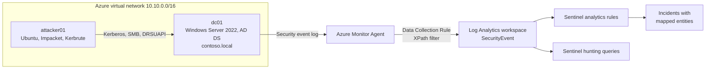

# Architecture

## Data flow

1. Advanced audit policy on the DC decides which events exist. Without the right
   subcategories nothing downstream can fire ([lab setup, step 5](lab-setup.md#5-turn-on-the-audit-policy)).
2. The Azure Monitor Agent reads the Security log and authenticates with the VM's
   managed identity. No workspace key is stored on the host.
3. The Data Collection Rule filters to nine event IDs with an XPath query and sends
   them on the `Microsoft-SecurityEvent` stream ([deploy/dcr-securityevent.json](../deploy/dcr-securityevent.json)).
4. Events land in `SecurityEvent`: common fields as typed columns, the full payload as
   XML in `EventData`.
5. Scheduled analytics rules run on their frequency over their period. Any returned
   row raises an alert; entity mappings attach account, address and host.
6. Hunting queries run on demand over longer ranges, without thresholds.

## Event collection

| Event ID | Meaning | Used by |
|---|---|---|
| 4624 | Successful logon | DCSync (source address), password spraying hunt |
| 4625 | Failed logon | Password spraying |
| 4662 | Operation performed on a directory object | DCSync |
| 4742 | Computer account changed | DCShadow |
| 4768 | Kerberos TGT requested | AS-REP roasting, Golden Ticket, password spraying hunt |
| 4769 | Kerberos service ticket requested | Kerberoasting, Golden Ticket |
| 4770 | Kerberos service ticket renewed | Golden Ticket |
| 4771 | Kerberos pre-authentication failed | Password spraying |
| 5136 | Directory object modified | DCShadow, AdminSDHolder |

Sentinel's built-in "Common" collection tier does not include 4662, so DCSync needs
either the "All Security Events" tier or a custom XPath filter. The lab uses a custom
filter: it collects what the content reads and nothing else, which keeps ingestion
small enough for a trial workspace.

## Design decisions

**Raw Windows events, not Defender for Identity.** `IdentityLogonEvents` and the other
Defender for Identity tables would simplify some of these detections, but they need a
licence a trial subscription does not include. Everything here runs on
`SecurityEvent`.

**Typed column first, `EventData` second.** For 4768 to 4771 the queries read
`ServiceName`, `Status`, `TargetUserName` and `IpAddress` from the typed column when
it is populated and fall back to extracting the same field from `EventData`.
`TicketEncryptionType` and `PreAuthType` have no typed column in `SecurityEvent` and
are always read from `EventData`. The column list the queries may use is in
[tools/securityevent.schema](../tools/securityevent.schema), checked against the
Azure Monitor table reference.

**Normalise before comparing.** 4768 records `alice`, 4769 records
`alice@CONTOSO.LOCAL`, and both record IPv4 addresses as `::ffff:10.10.1.5`. Every
query lower-cases the account, drops the realm and strips the IPv6 prefix before any
join or count. The Golden Ticket join matches nothing without this.

**Aggregate across domain controllers.** Counts are grouped by account and source,
not by reporting DC, so activity spread across several DCs still reaches the
threshold. The reporting DCs are kept in a `DomainControllers` column.

**Overlap scheduled runs.** Sentinel runs scheduled rules about five minutes behind
real time. Each rule's window is its frequency plus five minutes, so no slice of
events falls between two runs. Incident grouping on matching entities absorbs the
occasional duplicate alert.

**Thresholds in the query, allow-lists in watchlists.** Thresholds are `let` statements
at the top of each query: they change rarely and belong under review with the logic.
Lists that change with the environment live in two Sentinel watchlists, read with
`_GetWatchlist()`:

| Watchlist | Search key | Holds |
|---|---|---|
| `ADDomainControllers` | `SamAccountName` | Computer account of every DC |
| `ADDetectionExclusions` | `Value` | Per-detection exclusions with `Reason`, `Owner` and an optional `ExpiresOn` |

An exclusion stops applying after its `ExpiresOn` date, so a temporary exception does
not become permanent by default. The source CSV files are in
[watchlists/](../watchlists/) and the linter checks them: every `Detection` value must
name a detection folder and every date must parse. Queries read CSV columns through
`column_ifexists()`, as Microsoft's own content does, so a missing or empty watchlist
yields an empty list rather than a query error.

**Enablement is a deployment parameter.** The ARM template's `enableRules` parameter
defaults to false. Rules go live once the watchlists, the DC list in particular, are
populated for the environment, and every later deployment passes the same value so a
routine redeploy does not switch rules off.

## Trust boundaries

| Boundary | Control |
|---|---|
| Internet to lab network | NSG allows RDP and SSH from one operator address only |
| Host to workspace | Managed identity, no shared key on disk |
| Repository to Azure | No identifiers or credentials in the repository; deployment takes the workspace name as a parameter |
| Contributor to `main` | CI runs on every push and pull request with a read-only token |

## Limits

- One domain controller. The Golden Ticket rule assumes Kerberos events from every DC;
  in a multi-DC domain a missing DC produces false positives.
- No endpoint telemetry. These are directory-side detections only; process activity on
  the attacking host is not visible.
- Scheduled rules are not real time. Worst-case delay is the rule frequency plus
  ingestion latency.
